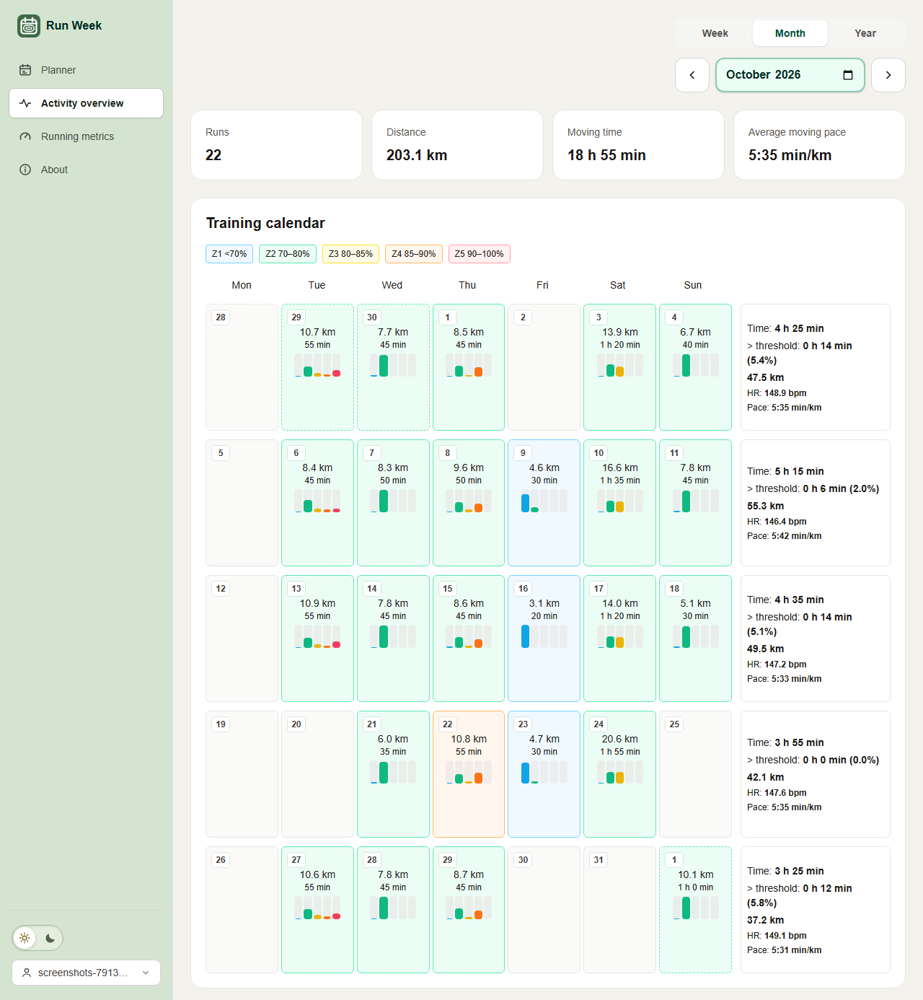
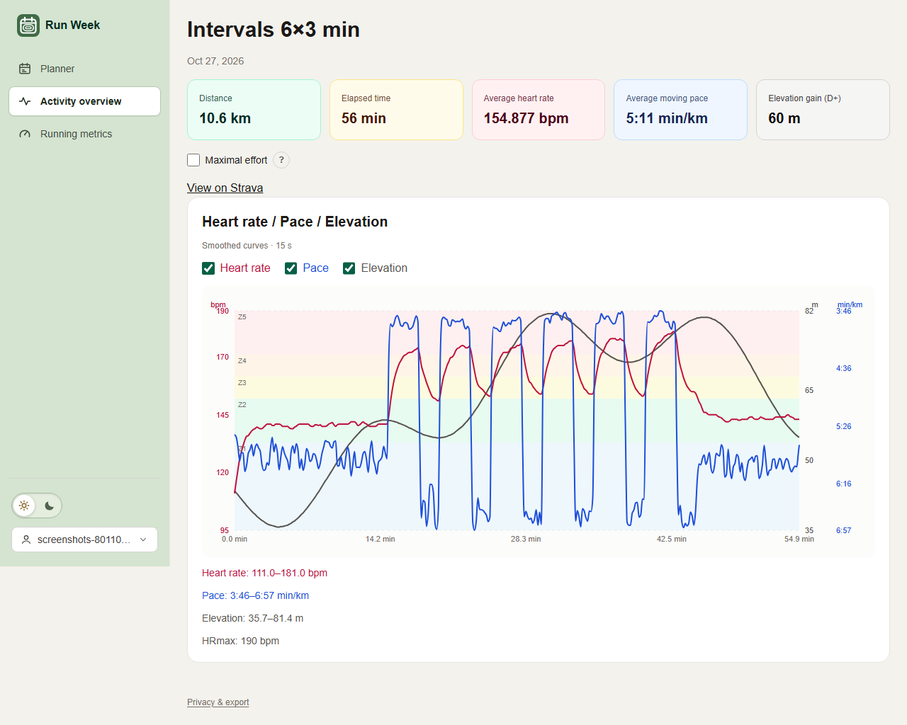
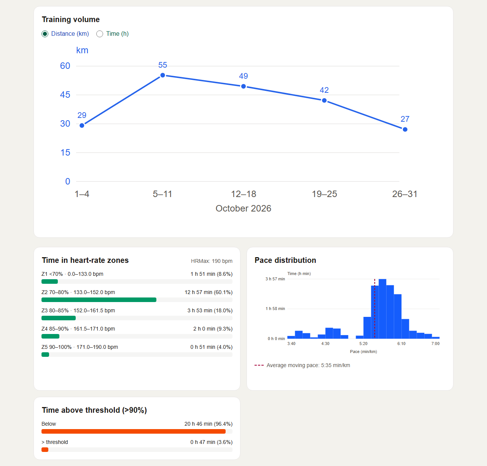

# Run Week

A running planner built with Next.js App Router, React, TypeScript, Tailwind
CSS and ESLint, with optional accounts (Auth.js, PostgreSQL through Prisma).


Activity screenshots use synthetic data.







## Getting started

Use Node.js 24 LTS, npm and Docker (or another PostgreSQL 15+ server). From
this directory:

```sh
npm ci                  # also generates the Prisma client
cp .env.example .env.local   # set AUTH_SECRET; adjust DATABASE_URL if needed
docker compose up -d    # local PostgreSQL on port 5432
npm run db:migrate
npm run dev
```

Open [localhost:3000](http://localhost:3000).
On Windows, use `npm.cmd` if PowerShell blocks `npm.ps1`. Without
`AUTH_RESEND_KEY`, development sign-in codes are printed to the dev server
console.

## Android app

The [mobile](mobile) directory contains a React Native app built with Expo, not a
WebView. It shares the web planner's TypeScript domain logic, validation and
translations. The existing Next.js app remains the backend; deploy the new
mobile API routes before using an installed app.

Install the root dependencies first (`npm ci`), then:

```sh
cd mobile
npm ci
npm run typecheck
npm test
npx expo run:android
```

Running Android locally requires Android Studio, an SDK, a compatible JDK and an
emulator or USB-connected device. Google sign-in and Garmin use the system
browser and return through `runweek://auth`; use an Android development build,
not Expo Go, to test that callback.

The native startup loads `Intl.PluralRules` support and locale data before the
shared translations are used: Android's Hermes engine does not supply that API.
`npm test` in `mobile` checks pluralization in all supported languages with the
native API removed, and checks changed versus equivalent training parameters.

On Android, use **Edit setup** to change parameters. The save-and-regenerate
button appears only when parameters differ from the saved plan and disappears
if those changes are reverted. Selecting an equivalent performance distance
alone does not require regeneration.

When signed in on Android, the account planner always takes precedence over
the device planner, including when the account has no saved plan. A failed
account load shows a retry error rather than switching to the device planner.
The signed-out device planner remains unchanged.

If requesting an email code returns 503, inspect the backend's
`mobile_request_failed` JSON log. It includes a request ID, the failed operation,
safe Prisma error codes or email-provider HTTP status, and configuration-presence
flags, not credentials or email contents. Configure `AUTH_SECRET` and
`DATABASE_URL` in the repository root's `.env.local` (not only in `mobile`), start
PostgreSQL and apply migrations. To actually deliver email in local development,
also set `AUTH_RESEND_KEY` and a verified `AUTH_EMAIL_FROM`; without the key,
development codes are printed in the backend terminal instead.

Set `EXPO_PUBLIC_API_URL` in the mobile environment to your backend's HTTPS
origin (defaults to `https://run-week.fyi`). For an Android emulator with the
backend running locally, use `http://10.0.2.2:3000` in development. A physical
device needs a reachable development server address. Never put database,
Resend, Auth.js or Garmin secrets in the mobile environment.

For local Garmin browser authentication in the Android emulator, forward the
backend port before connecting:

```powershell
& "$env:LOCALAPPDATA\Android\Sdk\platform-tools\adb.exe" -s emulator-5554 reverse tcp:3000 tcp:3000
```

This makes `http://localhost:3000` in the emulator reach the computer's backend,
including browser handoff URLs and a localhost Garmin callback. Keep the backend
running and repeat the command after restarting the emulator; use its actual
serial from `adb devices` if different. The `GARMIN_REDIRECT_URI` must still match
the callback registered with Garmin. A physical phone without USB forwarding
needs a reachable HTTPS backend and matching registered callback instead.

Only native authentication and browser handoff endpoints are under `/api/mobile`.
The app uses the existing `/api/planner`, `/api/account` and `/api/garmin/*`
endpoints directly, authenticated with its bearer token. Browser cookie
requests retain their existing same-origin checks. Email-code sign-in uses the same Resend
delivery, code expiry and attempt limits as the website. Native sessions are
independent of browser sessions: a revocable bearer token is stored in Android
secure storage, and only its SHA-256 hash is stored in the existing `Session`
table. Sessions expire after 30 days; signing out revokes the mobile session.
Planner, account and Garmin requests reuse the existing server-side validation
and operations under that authenticated account. Browser cookies alone cannot
authenticate the native session-management endpoint. Invalid bearer tokens
never fall back to a browser cookie.

Google sign-in uses the existing website sign-in screen in the system browser.
Garmin authorization remains on the existing HTTPS callback; no new Garmin or
Google provider callback registration is needed for the app return. Short-lived
browser tickets bind the flow to a SHA-256 PKCE challenge, and a single-use,
60-second code is exchanged by the app. No session token is put in a redirect
URL. Garmin linking uses the account signed in on Android even if the browser
is signed in to a different account. Tickets use the existing
`VerificationToken` table; no database migration is needed.

The mobile integration tests in [e2e/mobile.spec.ts](e2e/mobile.spec.ts) cover
email code limits, session revocation, account isolation, planner sharing,
PKCE/replay protection and Garmin linking, sending and disconnecting against the
mock server. They do not replace testing the Android app on a device.

## Website Strava activity dashboards

`/activities` provides a month calendar, real run summaries, configured HR-zone
and threshold duration charts; `/activities/[id]` shows recorded non-GPS streams.
`/running-metrics` includes critical speed for explicitly confirmed whole-activity
maximal race/test efforts. Marked efforts supply descriptive speed indicators and
theoretical Daniels VMA/threshold estimates; training history supplies demonstrated
endurance. These are not physiological measurements or standardized fitness scores.
The planner has an activity navigation entry and still works signed out.
This integration does **not** change Garmin workout sending or the Android app.
Strava is a separate connection, not an Auth.js sign-in provider.
The signed-in account menu provides Strava connect/disconnect controls on every
page. Connection status reads only the local database, never Strava. Connecting
opens consent; disconnecting confirms removal of local imports and tokens while
keeping original Strava activities. Failed disconnects remain actionable in the dialog.
The planner's activity link is shown only when signed in. Activity overview,
metrics and detail pages require a current Strava connection and otherwise
prompt the signed-in user to connect.

If `strava_request_failed` appears in backend logs, diagnostics include a request
ID, operation, safe Prisma error code/type, configuration-presence flags and an
actionable hint, never tokens or activity contents. Upstream failures also include
the stage (request/token/summaries/streams), reason (such as timeout, HTTP error,
schema validation, timestamp order or sample alignment), HTTP status when relevant,
and rejected schema field names, without response bodies or field values.
`P2021`/`P2022` indicates a
missing table/column: check `npx prisma migrate status`, then apply pending
migrations to the intended database with `npm run db:deploy`.

Configure server-only `STRAVA_CLIENT_ID`, `STRAVA_CLIENT_SECRET`,
`STRAVA_TOKEN_ENCRYPTION_KEY` (at least 32 random characters, independent of Garmin;
never use a development fallback) and `STRAVA_REDIRECT_URI`.
Register callback domain `run-week.fyi` in your Strava API application and use
`https://run-week.fyi/api/strava/callback`. Local development may use
`http://localhost:3000/api/strava/callback` with the corresponding registered domain.
Set `PRIVACY_HOSTING_PROVIDER` as described in the privacy configuration before
authorization. Review Strava's API agreement, application/athlete capacity and
branding requirements before enabling the feature in production.

Consent `2026-11-04-v1` requests only `read,activity:read_all` (including private
runs). The documented Strava OAuth flow does not specify PKCE; this integration
uses encrypted HttpOnly, SameSite=Lax cookies, random state bound to the signed-in
website account, and cancellable one-use database tickets with 10-minute expiry.
Access and refresh tokens are AES-256-GCM encrypted on the server. A keyed athlete
identity uniquely links an athlete to one Run Week account. Never rotate the
encryption key without reconnecting/migrating both tokens and athlete keys.
After successful Strava authorization, a conflicting link identifies the existing
Run Week account by email. The notice is carried in a short-lived, encrypted,
HttpOnly cookie bound to the requesting account, not in redirect URLs or logs.

Strava connection queues a full running-history import in PostgreSQL, atomically
with saving the encrypted connection. Inngest executes it through signed requests
to `/api/inngest`. Each durable chunk performs at most one Strava request: token
refresh, a 200-summary page, or one missing recording. Checkpoints are committed
with imported rows; successful steps never return activity data or tokens to Inngest.
`await inngest.send(...)` waits for Inngest to accept the event, not for the import
to finish. Inngest matches `strava/sync.requested` to `strava-background-import`
and calls the registered `/api/inngest` endpoint with signed HTTP requests.
The handler and its `syncChunk` steps execute in the deployed Next.js application;
Inngest manages scheduling, completed-step results, retries and durable sleeps.
During a sleep no Vercel request needs to remain open. The production Inngest app
must be configured and synced with the endpoint for these jobs to run.
The job runs even when the browser closes, signs out, changes pages or selects
another date. Activity endpoints only read committed database rows and return
partial results immediately. Calendar navigation does not start synchronization.
There are no manual synchronization or Stop controls. `/api/strava/sync` only
supports GET for job status; manual POST/DELETE requests return 405. Account
connection and the backend scheduler create jobs, reusing any active account job.
Disconnect/account deletion
cascades jobs; connection generations and leases prevent stale writes after reconnect.

The app polls a database-only job status endpoint every five seconds while a
job is queued/running/paused, and every minute otherwise. Progress refreshes stored
dashboard data; polling never calls Strava. Progress banners and counters are hidden;
network/status failures are still shown explicitly.
The PostgreSQL outbox is checked every ten minutes for queued, unpublished jobs,
including after a failed event send. Connection still publishes an import immediately;
only recovery of a failed publication can wait up to ten minutes. Empty outbox checks
and hourly scheduling checks appear as Inngest runs even when all activities are synced;
they do not call Strava or re-import completed jobs. Together these two schedules
produce 168 maintenance runs per day, excluding imports and retries.
The hourly scheduler checks accounts due for a daily incremental import; it overlaps
the last synchronization by one day to cover timestamp boundaries. Transiently
failed imports are resumed from their saved page/phase on a later scheduler run.
Previously cancelled jobs are also resumed when due. Invalid or revoked
authorization requires reconnecting Strava, rather than repeated automated requests.

Historical coverage is stored as successful date intervals in `syncHistory`, not
separate week/month/year flags. Imports subtract covered intervals and process the
remaining gaps, including empty periods. Current-day coverage stays provisional;
incremental imports discover newer activities. Existing ready/unavailable recordings
are retained, unique account/source IDs prevent duplicates, and every committed
chunk invalidates dashboard caches. App-wide database quota reservations and Inngest
concurrency serialize calls; read-limit headers/429 pause jobs using durable sleeps.
Transient chunk failures have five Inngest retries, then a visible failed job
eligible for a later automatic retry.
Existing accounts must reconnect for consent version `2026-11-05-v2`.
TanStack Query retains activity dashboards in account-scoped browser memory for
five minutes. It deduplicates reads and does not refetch on focus/reconnect or retry
failed requests. This cache is not written to localStorage and is discarded on
sign-out/account changes; disconnect clears activity queries.
Locally, run `docker compose up -d redis` and set server-only
`REDIS_URL=redis://127.0.0.1:6379` for the five-minute Redis cache.
Production (`NODE_ENV=production`) uses Upstash REST instead: set
`UPSTASH_REDIS_REST_URL` and `UPSTASH_REDIS_REST_TOKEN` (read/write token).
Production ignores `REDIS_URL`; local development ignores the Upstash variables.
Both the activity cache and Garmin rate limiter use this environment-selected backend.
Dashboard snapshots and successful period-import markers are encrypted with the
Strava encryption key and keyed by an opaque account hash. Repeating a completed
period import within five minutes makes no Strava requests. Incomplete/failed
imports are never marked complete. Mutations invalidate dashboard snapshots;
disconnect, reconnect and account deletion remove the account's Redis entries.
The database remains authoritative and authorization is checked before cache reads.
Redis entries have independent five-minute expirations. Redis is optional when the
selected backend is unconfigured (a server warning is logged); a configured but unavailable Redis
service produces an explicit error, not a misleading synchronization success.
Include the Redis hosting provider in `PRIVACY_HOSTING_PROVIDER`.
Strava exposes paginated activity summaries and a separate stream endpoint per
activity, not a bulk monthly/yearly stream endpoint. Importing HR/pace history
therefore still needs one stream request per activity; already imported streams
are retained and not fetched again by incremental synchronization.
Periods use activity-local calendar dates; upstream timestamp queries include a
one-day boundary margin to cover timezone offsets. Imports do not delete data
outside the selected period. Disconnect is
available in privacy controls and deletes all local imports and tokens; original
Strava activities remain unchanged. Only Run, TrailRun and VirtualRun are retained.
Streams request only `time,heartrate,velocity_smooth,distance`; no GPS, profile
details, AI or Garmin activity API is involved. Missing HR remains null. Available
streams are retained on reimport; Strava deletions are not automatically
reconciled (disconnect removes everything locally).
Numeric summary heart rates outside 30–240 bpm are imported as unavailable, just
like invalid recorded HR samples, rather than blocking the whole summary page.
A sanitized warning records excluded-field counts, never activity values or IDs.
Incorrect field types still fail validation.
Repeated stream timestamps are collapsed to their last sample, using the same
indices for HR, speed and distance; zero-duration duplicates cannot add zone time.
A sanitized warning reports only the removed count. Decreasing timestamps and
mismatched sample-array lengths still fail explicitly rather than inventing timing.
Activity detail pages read stored samples; pending recordings are filled by the
background job. Missing heart-rate recordings remain unavailable rather than
being estimated. New/imported activity edits outside the incremental overlap and
Strava deletions are not reconciled automatically; Strava webhooks are not yet installed.

### Inngest setup

1. Create an Inngest app/environment and install its Vercel integration.
2. Set server-only `INNGEST_EVENT_KEY` and `INNGEST_SIGNING_KEY` in Vercel Production.
   Production forces cloud mode; never use development keys or `INNGEST_DEV` there.
3. Apply `20261105090000_strava_background_jobs` (the production Vercel build runs
   migrations), deploy, and verify `/api/inngest` is synced in Inngest. Check that
   `strava-background-import`, `strava-sync-outbox` and `strava-incremental-sync`
   are registered. Allow signed Inngest requests through deployment protection/WAF.
4. Reconnect Strava under the updated consent. Verify a queued import becomes running
   and then completed, including after leaving the site. Do not disable signature verification.
5. Include Inngest in the deployment's processor disclosure and configure execution
   history retention/access. Events contain opaque job IDs/version only; control
   results contain timing/completion metadata, not identity, workouts or OAuth tokens.

For local development run `npx inngest-cli@latest dev -u http://localhost:3000/api/inngest`
and set `INNGEST_DEV=1` in the app environment. Use separate production/preview/local
databases and Inngest environments. Preview deployments must not execute production jobs.
`node scripts/verify-strava-background.mjs` exercises checkpoints, filtering, retries,
quota pauses and cancellation/reconnect fencing with mocks. The Playwright suite uses
a local delivery/worker harness on port 3103 and a disposable database; it requires
Docker and never contacts Inngest Cloud or real Strava.
Inngest's transitive Zod dependency uses the patched root package via an override;
the SDK imports the supported `zod/v3` compatibility entry point.

Calendar HR/pace statistics use the full displayed calendar range, including
adjacent-month boundary days (at most 1,000 displayed runs). Monthly headline
totals use the selected month only; performance metrics use all marked efforts.
The activities calendar supports yearly, monthly and Monday–Sunday weekly views.
Previous/next arrows move one month or week; a prominent native date/month
picker opens when clicking anywhere in its input. The selected view and date
are kept in the URL. Weekly headline totals and statistics use that week's runs,
including days crossing month/year boundaries.
Year view uses January 1–December 31 without adjacent-year days, includes all
imported runs in that year (not the monthly 1,000-run display limit), and shows
annual distance, moving time, pace, HR-zone and threshold statistics, plus the pace histogram.
Twelve monthly cards link to their month view and show measured HR-zone bars.
Hover or keyboard focus opens a viewport-positioned summary with monthly distance,
moving time, weighted average HR, pace and zone durations/percentages.
Arrows and the year selector navigate between years.
The simplified UI temporarily uses a shared HRmax preset of 190 bpm, not a
personalized measurement. Manual HR settings and maximal-effort confirmation
controls are hidden on the dashboard. Each activity detail has a saved maximal-effort
checkbox and hover/focus help explaining provisional performance, critical speed
and D′, minimum effort requirements and elapsed-time use. Race-equivalent VDOT
does not update the planner or change HR zones.
Existing stored settings/confirmations remain intact;
stored HR settings do not override the preset.
Zones are Z1 <70%, Z2 70–80%, Z3 80–85%, Z4 85–90%, Z5 90–100% HRmax;
lower bounds are inclusive and upper bounds exclusive except 100% in Z5.
Above threshold is strictly >90% HRmax (exactly 90% is not above threshold).
Intervals over 15 seconds, missing/invalid HR and HR above configured HRmax are
excluded. Calendar day colors use the zone with the most measured time across
the day's runs (ties choose the lower zone); missing HR is unclassified.
Workout planning is available at `/planner`; `/` redirects signed-in users to
`/activities` and signed-out users to `/planner`, based on their account session.
The same top navigation, language/account controls and page gutters are shared
across the website. Each Monday–Sunday week includes total kilometers, moving time
in hours/minutes, measured time above threshold, moving-time-weighted average HR
(excluding activities without HR), and average moving pace (total time / distance).
Boundary weeks include adjacent-month days.
Calendar cells replace the separate run list: hover or keyboard focus shows each
run's distance, moving time, average HR and moving pace. Each active day shows a
five-color HR-zone bar chart based on valid recorded interval durations, with all five
percentages in the floating summary (combined across runs for multi-run days).
Day and weekly hover cards open above or below based on available viewport space,
reposition on scrolling/resizing, and scroll internally if necessary.
Percentages use measured HR time only; missing samples are not inferred.
Days without valid HR intervals show neutral bars and unavailable percentages.
Single-run cells link directly to details;
multi-run cells open an activity chooser (also usable by touch and keyboard).
Same-day activities are ordered by start time, earliest first. Cells show a
top-left date badge, total moving time, and a run count when there are multiple runs.
Maximal efforts have a purple star in the day cell and a label in the hover card.
The bottom of the Running Metrics page lists all marked efforts, regardless of the selected period,
with direct links to their details. Each has a trash button that asks for confirmation
before removing only the maximal-effort mark. The activity remains in the calendar
and on Strava; performance metrics are recalculated.
Period controls cannot select future weeks, months or years. Future URL periods
redirect to the current period; future months in the year overview are disabled.
Day cells and weekly summary cells share a uniform height, including empty days.
Request failures display in red for three seconds; successful imports clear stale
import errors. Dismissing an error does not retry failed requests or hide retry limits.
Weekly summary cells also open on hover, focus or tap, combining the week's
distance, moving time, distance-weighted pace (total time / total distance),
moving-time-weighted average HR, and measured time/percentage in each HR zone.
All summary durations use hours and minutes, rounded to the nearest minute.
The training-volume chart below the calendar switches between distance (km, blue)
and moving time (hours, green), with one series selected at a time and its axis
always on the left. Points display their values and are joined by lines. Displayed distances are
rounded to the nearest kilometer; point positions retain the exact totals.
Month view labels the X axis with the selected month's localized name and year.
Year view groups
by month, month view by Monday–Sunday weeks clipped to that month's dates, and
week view by day. Empty buckets remain visible as zero. Hover or keyboard focus
shows exact totals, with duration in hours/minutes. It uses all stored summaries
for the selected period, not the calendar display limit, and makes no Strava calls.
Distance-axis ticks are multiples of 5 km; duration-axis ticks are whole hours.
Both axes round up to cover the largest bucket without rounding the underlying totals.
The average-weekly-volume card is no longer displayed.
Synchronization is automatic and independent of the selected calendar period.
Successful imports persist completed date intervals; unfinished periods remain
provisional. A same-athlete reconnect preserves history; disconnect deletes it.
This requires the `20261104200000_strava_sync_history` database migration.
Weekly summaries use compact labels and show measured above-threshold time as a
percentage of the week's full moving time, not just its HR-covered duration.
The pace distribution is a histogram with a linear seconds/km horizontal axis
(labels use min:sec/km) and measured time in hours and minutes on the vertical axis.
It has no named training categories and does not require a saved plan or VDOT.
The slow-end cutoff is the selected period's time-weighted 99th-percentile pace,
not a fixed speed: at most 1% of valid recorded time is omitted. All samples tied
at the cutoff stay included, so sustained slower running is retained.
The horizontal axis ends at the cutoff rounded up to the bin boundary.
Equal-width numeric bins span qualifying samples through that cutoff; width adapts
in five-second/km steps, keeping at most 25 bars. Each sample contributes its
recorded interval duration exactly once; bars can be inspected with hover or keyboard focus.
The dashed vertical line shows average pace (included time / included distance),
excluding the same slow-tail intervals. This is a display heuristic, not walking
detection. Bar details use hours and minutes and appear only on hover or focus;
the chart does not display a separate total-duration label.
Only recorded speeds of at least 0.5 m/s and intervals up to 15 seconds count.
Missing speed data shows unavailable, not a fabricated distribution.
No measured HR means unavailable, not zero. Older manual zone/threshold values
remain stored for deployment compatibility but no longer define these calculations.
Critical speed reuses the
user-owned running-data OLS method: ≥3 confirmed maximal efforts, distinct
durations of 2–120 minutes, R² ≥ .90, nonnegative D′. It uses elapsed time,
including stops, and is descriptive, not personalized training advice.
Metrics use maximal efforts across all imported dates. The metrics page has no sync
button, period picker or period-summary cards; synchronization runs in the backend. Without a reliable
multi-effort fit, even one eligible marked effort supplies a provisional average
speed and race-equivalent VDOT using the fastest effort's elapsed-time speed and
the planner's existing Daniels–Gilbert equation. A low-confidence warning is shown;
these values are not critical speed, and no D′ or fit quality is invented. They do
not update the planner or HR zones.
The Speed, Endurance and Speed-endurance cards show descriptive estimates, not
validated physiological measurements or scores. Speed reuses the fastest marked
effort's elapsed-time average (km/h and min/km), not sprint speed or VMA.
Endurance shows the longest imported run by moving time in the last 84 calendar
days, including today, with distance and a link to the source activity; future
activities are excluded. It indicates demonstrated volume, not maximal capacity.
Speed-endurance is critical speed divided by fastest marked-effort speed × 100,
only when the existing critical-speed fit is reliable and the ratio is valid
(0–100%). Otherwise it stays unavailable. Results depend on the imported history,
effort durations and dates; they are independent of the selected calendar period.
Each card has a localized definition available by hover, keyboard focus or tap,
with Escape to dismiss.
Calendar cells use shallow prop memoization, and year-view activities are grouped
once per data change rather than scanned for every month on each render. Activity
chart data and bounds are memoized by recorded points. The shared import controller keeps stable actions and context values
when its state is unchanged; synchronization behavior and cache policies are unchanged.
VMA, threshold pace and threshold/VMA are theoretical Daniels estimates from the
same maximal-effort VDOT: invert the existing oxygen-cost equation at 100% VDOT
for VMA and 88% for threshold (approximately one-hour race effort); divide
threshold speed by VMA speed for the percentage. Values are explicitly low
confidence, not measured VMA or lactate threshold. No valid VDOT means unavailable.
Activity detail elapsed duration is rounded to the nearest minute and displayed
as hours and minutes, like the calendar summaries.
Activity details omit the recorded-stream heading, manual continue-import button
and back-to-overview link. Background import progress banners and counters are
not displayed; imports, status polling and data refreshes continue on all pages.
Activity details use Recharts for a responsive heart-rate/pace chart with separate
axes, colored Z1–Z5 background bands and independent HR/pace checkboxes. Values are
available in a crosshair tooltip using pointer, touch or left/right arrow keys.
The chart uses subtle horizontal gridlines and disables animation.
Pace is displayed as minutes:seconds per kilometer; zero speed and missing recordings
break the line rather than producing infinite pace. Near-stationary speeds below
0.5 m/s (slower than 33:20 min/km) are also excluded from pace charts and pace-zone
distributions, not clamped to invented paces. The histogram additionally excludes
the slowest insignificant tail by recorded time. Raw imported samples are retained.
Distance is no longer charted.
Displayed HR and speed samples use a three-point median followed by a centered
15-second rolling mean before downsampling. Pace is converted from smoothed speed;
curve segments use monotone interpolation without overshooting sample values.
Smoothing does not cross missing samples or recording gaps above 15 seconds.
Raw stored data, HR-zone time, threshold totals and pace histogram durations are unchanged.
Account export includes all imported summaries/streams, confirmations, settings
and consent metadata, never tokens or athlete keys. Disconnect deletes imports,
settings, tokens and pending OAuth tickets and prevents stale sync writes.
Account deletion cascades all of this data. Originals in Strava remain; revoke
Run Week access in Strava settings too. Consent/disclosures and new analytics UI
are localized in all ten website languages; the existing general privacy policy
remains English.

Migration `20261104130000_strava_activities` only creates new tables/indexes and
foreign keys; previous deployments remain compatible. Use `npm run db:migrate`
only against a known development database or `npm run db:deploy` in the existing
deployment process. `scripts/prisma-offline.config.ts` allows schema validation
and client generation without loading environment files or selecting a database.
Migration `20261104150000_analytics_max_hr` adds nullable `maxHr` to analytics
settings; it remains backward-compatible while manual settings are hidden.

Public references: [Strava OAuth](https://developers.strava.com/docs/authentication/),
[API summaries/streams](https://developers.strava.com/docs/reference/),
[rate limits](https://developers.strava.com/docs/rate-limits/).
Patterns adapted from the user's `running-data` pure analytics and `runcoach-ai`
Strava importer, without its single-athlete storage, auth fallback or AI code.

## Command reference

| Command | Purpose |
| --- | --- |
| `npm run dev` | Start the development server |
| `npm run lint` | Run ESLint |
| `npm run typecheck` | Generate route types and check TypeScript |
| `npm run build` | Create the production build |
| `npm run build:vercel` | Apply migrations in Vercel Production, then build; other environments only build |
| `npm start` | Serve the production build |
| `npm run db:migrate` | Create and apply a migration in development (`prisma migrate dev`) |
| `npm run db:deploy` | Apply pending migrations in production (`prisma migrate deploy`) |
| `npm run test:e2e` | Run the Playwright end-to-end tests (see [End-to-end tests](#end-to-end-tests)) |

## Structure

```text
.github/
  agents/                 Project-specific coding and review agents
prisma/                   Database schema and migrations
src/
  app/                    Routes, API route handlers, root layout, global styles
  features/
    account/              Auth.js configuration, sign-in UI, privacy controls
    i18n/                 Locales, translated messages, language selector
    running-programs/
      components/         Running-program UI
      types.ts            Domain types independent of React
      domain.ts           Pure VDOT, schedule and workout generation functions
      storage.ts          Versioned planner validation
      use-planner-store.ts Hydration-safe browser store (signed out)
      use-account-planner.ts Account planner store (signed in)
    garmin/               Garmin Connect client hook and server-only API code
  generated/prisma/       Generated Prisma client (not committed)
public/                   Static assets
```

The home page supports performance/profile setup and a current-week plan.
Signed out, the profile and current week are saved only in this browser's
localStorage; clearing browser data deletes them. Signed in, they are saved in
the account and shared across devices. Failed writes show a warning; invalid
saved data is not silently overwritten. System fonts keep builds independent of
external font services.

Signed-in users with marked Strava maximal-effort activities can choose
**Use maximal-effort activities** in the simulator setup. It fills the performance
fields from the eligible effort with the highest Daniels–Gilbert VDOT across all
imported dates, using elapsed time (including stops), not moving time. Distance and
time are rounded to whole metres/seconds to match form inputs. The existing
supported distance/time/VDOT limits apply; ineligible efforts are not used.
The option is absent when there are no marked efforts. It never replaces manual
input or regenerates a saved week without the existing save/confirmation flow.

VDOT uses the Daniels–Gilbert race-performance equations. Changing the
performance distance prefills the race time with the equivalent time for the
same VDOT, based on the last complete time entered. Setup can use an optional desired weekly distance or desired weekly time. A
distance target is converted to duration using VDOT easy pace; a time target is
used directly. The resulting duration is distributed among workouts by type and
neighboring sessions. Without a target, session durations use the VDOT-based
baseline: the first easy run is the longest, and each additional easy run is
shorter, by a larger step and down to a lower floor for lower VDOT values. Easy
runs next to a key session or the long run get the shorter durations. The long
run is always longer than every easy run: if needed, 10-minute blocks are moved
to it from the longest easy run, keeping the weekly total. Existing
local planner data is migrated by estimating volume from its
saved workout durations and VDOT pace.

Easy pace estimates invert the oxygen-cost equation at 59–74% of VDOT. Full
equations and limits are shown in the UI. The plan retains the VDOT/profile
snapshot used to create it. These are illustrative estimates, not personalized
training or medical advice.

Default workout categories follow the selected run count: one interval workout;
two runs (easy and intervals); three runs (intervals, easy, long); four runs (intervals,
two easy, long); five or more (intervals, easy, threshold, long, then additional
easy runs). The total weekly duration is allocated in proportion to workout-type
and neighboring-session weights. Workout and long runs are spaced as evenly as
the selected weekdays allow, with the long run favored for a weekend when
spacing is otherwise equal. Optional preferred days can be set for the interval
workout, the threshold workout, and the long run; each option is shown only when
the run count includes that session. With selected weekdays, preferred days must
be among them. With a run count, the run days are chosen to include the
preferred days and keep key sessions as far apart as possible. The displayed distance is a separate estimate based
on the VDOT easy-pace range. These are product heuristics, not scientifically
validated training rules.

Advanced options allow each existing key-session slot to be changed to intervals,
threshold, repetition or long run, with a separate preferred day for each slot.
The highlighted "Skip workout" option replaces that slot with an easy run;
its day preference applies unless it shares a day with another slot. In that case,
skipped slots become easy runs on other scheduled days and a real workout keeps
the specified day. Only conflicting non-skipped workouts cause a duplicate-day
error. Remaining key sessions are spaced around the easy runs.
The question-mark button beside each workout type shows a short paraphrase of
Daniels' training definition for the selected type on hover, keyboard focus or
tap. Escape dismisses it. Definitions are translated into all supported languages.
Jack Daniels is credited in the bottom method-and-limits text rather than in
each workout tooltip. Conflicting workout days show errors under every affected
workout, and changing a day revalidates all day selections.
All form dropdowns and the language selector use the same accessible dropdown
component. Arrows rotate when menus open and close; reduced-motion preferences
disable the animation. Keyboard navigation supports arrows, Home, End, typing,
Enter, Escape and Tab.
Types may be repeated, including multiple long runs. The number of key-session
slots and easy runs remains unchanged; leaving the choices at their defaults
preserves the existing generation rules. Each long run remains longer than every
easy run. At the minimum weekly duration, enforcing this can exceed the target.
Duplicate workouts are user choices, not an assessment of safe training load.
Saved profiles without workout choices retain their defaults.

Interval sessions use VDOT-derived I-pace estimates and 3-minute repeats with
2-minute easy jog recoveries. Threshold sessions use VDOT-derived T-pace
estimates and continuous or repeated efforts, fitted to the planned session
duration. The pace ranges and example formats follow the [VDOT2 training
definitions](https://vdoto2.com/Calculator). These are illustrative sessions,
not individualized coaching advice.

Repetition (R) training develops speed and running economy, with short efforts
and full recovery rather than the incomplete recovery of I training. The
[official VDOT calculator's training definitions](https://vdoto2.com/calculator)
describe R pace as similar to current 1500 m or mile race pace, with example
formats of 8 x 200 m or 4 x 400 m and easy jog recovery. Recover fully before the
next repetition; extending recovery is preferable to forcing the next effort.

The planner estimates R pace by solving the existing Daniels-Gilbert performance
equation for an equivalent mile time at the saved VDOT, then converting it to
seconds/km. This is a continuous approximation, not an exact official R-table
lookup. Generated sets use 200 m repeats, or 400 m when the session is at least
50 minutes, each effort fits within two minutes, and the volume budget allows
at least two 400 m repetitions. Otherwise 200 m repeats are used. Warm-up and cool-down each
receive at least eight minutes, with a starting recovery of three times the
effort duration. Rep count is fitted to time and volume, not fixed to the examples.
If there is not enough room for two repetitions, or a 200 m effort would exceed
two minutes, the details explicitly prescribe easy running instead.

As a conservative product rule inspired by the
[Daniels five-week-cycle review](https://fellrnr.com/wiki/Jack_Daniels_Running_Formula),
total R distance is capped at the smaller of 5% of estimated weekly distance or
8 km, shared across all selected R sessions. The estimate uses the slower easy
pace and scheduled minutes, not measured training history. These limits and
session templates are illustrative heuristics, not personalized coaching.

Select a calendar day to view its workout details. The copy button copies the
week, including workout steps and paces, as plain text in the current language.
Non-easy workouts include an
option to download a Garmin FIT workout file. Files contain timed workout steps
or distance-based R repetitions
and VDOT-derived pace targets where available. Easy runs and long runs carry
their easy-pace range as step text only, without a pace target, so the watch
does not alert when the pace leaves the range. This also applies to Garmin
Connect uploads. Transfer the downloaded file to
a compatible Garmin device using Garmin Connect or the device's supported
file-transfer method. Easy runs do not have FIT downloads; files are generated
in the browser and are not uploaded automatically.

## Accounts

Accounts are optional; everything except Garmin Connect works signed out.
`/signin` offers a six-digit email code (Auth.js Resend provider, valid 10
minutes) and, when `AUTH_GOOGLE_ID`/`AUTH_GOOGLE_SECRET` are set, Google
sign-in. A Google sign-in with the same verified email joins the existing
account. Sessions are stored in the database (30-day HttpOnly cookie). Only
the latest code for an email is valid; at most 5 codes per email per hour are
sent, and 5 wrong entries invalidate the pending code. Provider OAuth tokens
are not stored.

When signed in, the planner is loaded from and saved to the account
(`GET`/`PUT /api/planner`) instead of localStorage. If the account has no plan,
the setup form is shown; the browser copy is left unchanged and returns when
signed out. The privacy page exports the account (`GET /api/account`) and
deletes it (`DELETE /api/account`), which removes all its rows.

| Variable | Description |
| --- | --- |
| `DATABASE_URL` | PostgreSQL connection used by the app. On Supabase, the pooled URL (port 6543, `?pgbouncer=true`) |
| `DIRECT_URL` | Optional direct connection for migrations (Supabase direct or session URL) |
| `AUTH_SECRET` | Random string of at least 32 characters (`npx auth secret`) |
| `AUTH_RESEND_KEY` | Resend API key; required in production for email codes |
| `AUTH_EMAIL_FROM` | Sender address on a domain verified in Resend |
| `AUTH_GOOGLE_ID`, `AUTH_GOOGLE_SECRET` | Optional Google OAuth client; redirect URI `<origin>/api/auth/callback/google` |

Migrations are applied before each Vercel Production build and by the
**Migrate database** CI job on each push to `main`
(see [CI and deployment](#ci-and-deployment)). To apply them by hand, run
`npm run db:deploy` with `DIRECT_URL` set to the production database. The email
body is in English.

## Garmin Connect

When configured, the week view can send runs to the Garmin Connect calendar.
Connecting Garmin requires an account; Garmin controls are shown only when
signed in. The main page shows a persistent connected status and disconnect
control, even before a training week is created. Connection state is shared with
the week and workout modal; status-request failures are reported rather than
silently hidden.
Connected users can send the week from its Garmin controls or one run from its
workout modal: the whole week (workouts and long run, or all runs) or a single day from the
day dialog. Each run becomes a Garmin workout scheduled on its date. Each sent
workout is recorded in the database with its date and Garmin workout ID (one per
day per account). Uploads skip days already recorded and report them as already
in Garmin instead of failing; concurrent uploads of the same day keep one
workout and delete the duplicate. The week view reads the recorded days
(`GET /api/garmin/workouts?weekStart=`) when it opens and on window focus, so
every tab and device shows the same state. Run Week does not read the Garmin
calendar.
Garmin Connect does not let users edit or delete workouts created by a partner
app, so the week controls and workout modal also offer "Remove from Garmin"
(`DELETE /api/garmin/workouts`), which deletes the recorded workouts for those
dates, along with their calendar entries.
Regenerating the week after a setup change first deletes that week's recorded
workouts from Garmin Connect; if the deletion fails, the week is not regenerated.
The connect menu item uses a locally hosted Garmin wordmark from the
[user-supplied logo source](https://zonalogo.com/garmin-logo-png-svg);
Garmin branding remains Garmin's trademark. Verify its use against the branding
requirements of your approved Garmin developer application.
Repetition workouts are accepted by the sync endpoint, with distance-based
efforts and R-pace speed targets. FIT exports retain the full week's R-volume
budget; Garmin sync generates each selected session independently using its
conservative session-duration-based R budget. Watch names for Russian,
Ukrainian and Belarusian use English.
Garmin workout names and embedded FIT names start with the full weekday in the
export language. Downloaded FIT filenames also start with the weekday (English).

The integration uses Garmin's Training API, which requires an approved
[Garmin Connect Developer Program](https://developer.garmin.com/gc-developer-program/)
application with the workout import permission. Copy `.env.example` to
`.env.local` and set these environment variables:

| Variable | Description |
| --- | --- |
| `GARMIN_CLIENT_ID` | Application consumer key |
| `GARMIN_CLIENT_SECRET` | Application consumer secret |
| `GARMIN_SESSION_SECRET` | Random string of at least 32 characters, used to encrypt stored Garmin tokens and the authorization cookie, and to derive quota keys |
| `REDIS_URL` | Local standard Redis connection, shared with the Strava cache; ignored in production |
| `UPSTASH_REDIS_REST_URL` | Production HTTPS REST endpoint for the shared cache and rate limiter |
| `UPSTASH_REDIS_REST_TOKEN` | Production server-only Upstash read/write token |
| `GARMIN_REDIRECT_URI` | Optional; defaults to `<origin>/api/garmin/callback`. Must be an HTTPS URL (HTTP is allowed only on localhost), without credentials or a fragment; register the exact URI with Garmin. |
| `PRIVACY_HOSTING_PROVIDER` | Required for new Garmin authorization; publicly names hosting, database, CDN/proxy and managed logging processors. |

For `https://run-week.fyi`, register the OAuth callback as
`https://run-week.fyi/api/garmin/callback` and the privacy policy as
`https://run-week.fyi/privacy`. `/garmin/consent` is the user-facing consent page,
not the OAuth callback. These URLs must be deployed and publicly reachable
before submitting the application. Set `GARMIN_REDIRECT_URI` to the exact callback.
For Garmin's branding image, use
`https://run-week.fyi/run-week-branding.png` after deployment. The public PNG is
300 x 300 pixels; it is not used as a favicon.

The privacy policy and consent pages are in English; the planner footer link is
localized. Consent is required before authorization; its version and time are
stored with the connection, and connections under an earlier version require
reconnection. Disconnecting first deletes every workout sent from the account
from Garmin Connect, then deletes the stored tokens and sent-workout records.
The menu always asks for confirmation before disconnecting Garmin, explaining
the deletion of sent workouts and stored access. Strava disconnect also uses a
confirmation dialog explaining the deletion of imports, HR settings and tokens
without changing original Strava activities. If Garmin rejects the
authorization, the account is disconnected anyway and the remaining workouts
are reported as left in Garmin Connect; other failures keep the connection so
the user can retry.
The privacy page provides JSON export of account and browser data, consent
withdrawal, browser-data deletion and account deletion. It never exports
credentials. Deleting the account does not delete Garmin-side workouts. Users
revoke the OAuth grant in Garmin Connect.

Before submitting the policy, identify all actual infrastructure processors in
`PRIVACY_HOSTING_PROVIDER`, verify their logging/retention settings and ensure the
operator website provides a working privacy-contact channel. No runtime AI or
analytics processors are configured. Do not add them without updating the policy,
consent requirements and processor disclosure. Never log tokens, cookies
or OAuth callback query strings. Have the deployment-specific policy reviewed;
this page is not a guarantee of Garmin approval or legal compliance.

Without them, the Garmin controls are hidden. Authorization uses OAuth 2.0 with
PKCE; the callback must be completed by the account that started it. Tokens are
stored AES-256-GCM encrypted in the database with the account and never reach
browser JavaScript. Redis stores only short-lived quota metadata. Disconnecting
deletes the stored tokens; revoke access in Garmin Connect account settings.

A Garmin account can be connected to only one Run Week account. The callback
reads the Garmin user ID (`GET /wellness-api/rest/user/id`) and stores an HMAC
of it (keyed with `GARMIN_SESSION_SECRET`) in the unique
`GarminConnection.garminUserKey` column. If another account already holds that
key, the connection is refused with `?garmin=alreadyLinked`, and the other
account must disconnect first. Reconnecting the same account with a different
Garmin account deletes its sent-workout records, which belong to the previous
Garmin account.

### Distributed upload limits (Redis)

Locally, run `docker compose up -d redis` and use
`REDIS_URL=redis://127.0.0.1:6379`; development uses the standard `redis` Node.js client.
Production uses Upstash's REST command API, with the original rate limiter's HTTPS
endpoint validation, read/write bearer token, bounded timeout, no redirects and no
automatic retries. Set `UPSTASH_REDIS_REST_URL` and `UPSTASH_REDIS_REST_TOKEN`;
review its region/retention settings and processor terms. Disclose Upstash in
`PRIVACY_HOSTING_PROVIDER`.
Use the same database and stable `GARMIN_SESSION_SECRET` across all production
instances/deployments, and a separate database for local development. Do not
expose any Redis configuration through `NEXT_PUBLIC_*`.

An authenticated, valid `POST` or `DELETE /api/garmin/workouts` reserves **one upload request**,
whether it sends one run or a batch of up to seven. Requests must start at least
**10 seconds apart in every environment**. There are **10 accepted requests per
UTC calendar day**, resetting at 00:00 UTC, except when the trusted server's
`NODE_ENV` is exactly `development` (`next dev`). No Origin, hostname or client
parameter can enable that exemption; production previews also have the daily cap.
The cooldown still applies across UTC midnight. Invalid/unauthenticated requests
and blocked attempts do not consume quota; accepted reservations do, including
failed/partial Garmin uploads or lost responses. There is no automatic refund
or retry, and this is not a per-workout or rolling-24-hour quota.

One atomic Redis Lua operation uses Redis server time to check and reserve both
limits before token refresh, deletion, creation or scheduling. Parallel requests
across Vercel instances cannot bypass the reservation. Rejections return typed
`rateLimited`, HTTP 429, `Retry-After` seconds and `retryAfterSeconds` JSON; the UI
shows the returned wait. Invalid Redis configuration, provider failures
or unexpected responses fail closed as generic HTTP 503 `unavailable`, with
sanitized `rateLimit` diagnostics and no fallback during provider failures.

When the selected backend is unconfigured (no local `REDIS_URL`, or neither
production Upstash setting), a synchronous in-memory reservation
enforces the same cooldown, UTC daily quota and development exemption. Expired
entries are removed on subsequent reservations. A structured warning identifies
this mode without exposing identities. State is shared only within one running
process, resets on restart/redeployment and is not shared across Vercel instances.
Use Redis for reliable distributed production protection; the memory fallback is
best-effort on serverless deployments.

The quota identity is an HMAC of the account ID under the Garmin session
secret, so limits apply per account across browsers and devices. Raw account
IDs, credentials and Garmin user IDs never go to Redis or diagnostics. Rotating
the session secret disconnects every account and resets quota identities; do
not rotate it routinely.

Redis quota records contain only the derived pseudonymous key, timestamp,
UTC-day counter and TTL, not tokens, workouts or Garmin activity data.
The same Redis instance can separately hold the encrypted Strava cache described above.
Quota records expire by UTC midnight or after the 10-second cooldown,
whichever is later (at most 24 hours); development records last 10 seconds.
Disconnect does not delete these records early. Review provider backups/logs
separately. Privacy and consent pages disclose Redis processing; include its
actual host in the infrastructure-provider disclosure.

Route handlers in `src/app/api/garmin`: `connect`, `callback`, `status`,
`disconnect` and `workouts`. Garmin's API documentation is available only to
approved developers; the endpoints and payload format in
`src/features/garmin/server` follow public implementations and were not tested
against a live account. Check them against the official documentation, in
particular the scheduling endpoint.

### Garmin diagnostics in production

Garmin failures emit structured JSON through server-only `console.error` (service,
network, invalid response, configuration or internal failures) or `console.warn`
(authorization, permission, rate limit, rejection or invalid input). On Vercel,
open the project's **Logs**, select the production deployment/environment and
filter for `garmin_failure` (include warning and error levels). No logging vendor
or additional environment variables are needed. These are runtime/function logs,
not browser console or build logs.

Each entry includes a generated request ID, a fixed operation (`refresh`,
`create`, `schedule`, `record`, `cleanup`, OAuth/status/disconnect, etc.), a
category, a safe frontend code, and, when applicable, the upstream HTTP status
and number of completed runs. Upload responses include the same ID in
`X-Request-ID` and JSON; localized week and workout-modal errors display it as a
reference. Other Garmin endpoints include it in the response header.

Uploads also emit `console.info` events sharing that request ID:
`garmin_upload_request` (the frontend JSON body), `garmin_api_request` (the
exact workout payload sent to Garmin, plus schedule/delete targets),
`garmin_api_response` (created workout ID) and
`garmin_upload_result` (HTTP status, error code and results, with `existing: true`
for skipped days). Removals emit `garmin_delete_request`,
`garmin_api_request` (`operation: "delete"`) and `garmin_delete_result`.
Filter by request ID to follow one upload.
Payloads above 16,000 characters are truncated. Failures from the Garmin
Training API include up to 2,000 characters of Garmin's error body as
`upstreamBody`; token-endpoint bodies are never read or logged.

Diagnostics never include credentials, cookies, tokens, OAuth codes, URLs
or original exception messages/stacks.
Unexpected exceptions are categorized as internal failures. Configure
Vercel/infrastructure retention and access appropriately; separately verify
that platform/proxy access logs do not retain OAuth callback query strings.

The UI distinguishes reconnect/permission/rate-limit, rejected workout,
unavailable service, network, invalid response and generic failures in all ten
languages. Transient refresh failures do not clear the session. Partial upload
successes remain recorded; scheduling and best-effort cleanup failures are both
logged under the same ID. Uploads are never automatically retried. After an
uncertain outcome, check Garmin before resending: an upstream write may have
succeeded despite a lost response, and failed cleanup can leave an orphan workout.

Run the focused mocked verification without calling Garmin:
`node scripts\verify-garmin.mjs`. It uses Node and the installed TypeScript compiler;
no test framework or real credentials are required. Redis commands, configuration
validation and failure paths are mocked as well. `npm run test:e2e -- garmin-accounts.spec.ts`
also exercises Garmin uploads and cooldowns against the disposable local Redis instance.

Edit setup to update the current plan. Confirmation dialogs protect plan
replacement and deletion.

## End-to-end tests

Playwright tests in `e2e/` cover accounts and Garmin: sign-in by email code,
Garmin controls hidden when signed out, one Garmin account per Run Week account,
reconnecting, sending and deleting a week, and deleting sent workouts before
regenerating. They also check that changing only the performance distance is
not a setup change.

Requirements: Docker running and Chromium installed once with
`npx playwright install chromium`. Then run:

```powershell
npm run test:e2e
```

- The tests start their own dev server on port 3100 (build directory
  `.next-e2e`, so `npm run dev` can keep running), a Garmin mock on port 3101,
  and a Strava mock on port 3102.
- Each run creates a new PostgreSQL container (`run-week-e2e-db`,
  `postgres:17-alpine`, `127.0.0.1:55432`, data in memory), applies the
  migrations, and removes the container at the end, with all test accounts.
  A disposable Redis container (`run-week-e2e-cache`, `redis:7-alpine`,
  `127.0.0.1:56379`, persistence disabled) verifies five-minute cache hits,
  expiry and invalidation and is also removed. Development databases/caches are
  not used. Do not run two e2e runs at once.
- Email delivery is disabled; the tests replace the stored sign-in code
  directly in the database.
- Garmin is never called. `GARMIN_E2E_MOCK_ORIGIN` redirects the Garmin URLs to
  the mock and is ignored outside development.
- Strava is never called. `STRAVA_E2E_MOCK_ORIGIN` likewise uses synthetic data.

## CI and deployment

`.github/workflows/ci.yml` runs on pushes to `main`, on pull requests to `main`
and manually. Its web and Android validation jobs need no secrets:

- **Lint, typecheck and build**: `npm run lint`, `npm run typecheck`,
  `npm run build`.
- **E2E tests**: `npm run test:e2e`. On failure, the Playwright report and
  traces are uploaded as the `playwright-report` artifact.
- **Android app checks**: installs the native app dependencies, type-checks
  the app and exports its production Android JavaScript bundle. This is not
  an APK build or emulator test.
- **Migrate database**: runs only on `main` (push or manual run), after both
  web jobs and the Android app checks pass, and applies pending migrations to production with
  `npm run db:deploy`. Runs never overlap or cancel each other. Pull requests
  skip it.

The migration job reads `DIRECT_URL` from the GitHub `production` environment.
In the GitHub repository:

1. **Settings → Environments → New environment**: name it `production`.
   Optionally add required reviewers to approve each migration, and restrict
   deployment branches to `main`.
2. In that environment, add the secret `DIRECT_URL`. On Supabase, use the
   **Session pooler** connection string (**Connect** → **Session pooler**, port
   5432, user `postgres.<project-ref>`). The direct host `db.<project-ref>.supabase.co`
   is IPv6-only and unreachable from GitHub-hosted runners.

Vercel deploys `main` through its GitHub integration.

The checked-in `vercel.json` sets the build command to `npm run build:vercel`.
When `VERCEL_ENV=production`, this runs `prisma migrate deploy` before `next build`.
Missing migration configuration or a failed migration fails the build, leaving
the current production deployment live. Preview/development builds skip migrations.
The ordinary `npm run build` remains database-independent for CI and local use.

Set `DIRECT_URL` in **Vercel Settings → Environment Variables**, scoped to
**Production** and pointing to the same database as production `DATABASE_URL`.
For Supabase use the Session pooler URL (port 5432), not the transaction pooler.
The GitHub secret is not automatically available in Vercel. Redeploy after adding
the variable to apply the pending Strava migrations and resolve `P2021`/`P2022`.
Do not promote a Preview build to production: deploy it as a Production build so
this migration step runs. `node scripts/verify-vercel-build.mjs` verifies the
build ordering and failure paths without connecting to any database.
The existing CI migration job stays as an additional gate; applying migrations
again is safe because Prisma only applies pending migrations.

To promote a production deployment only when all three jobs pass, in the Vercel project:

1. **Settings → Environments → Production**: keep automatic aliasing of
   production deployments on.
2. **Settings → Build and Deployment → Deployment Checks → Add Checks**: choose
   **GitHub** and select **Lint, typecheck and build**, **E2E tests** and
   **Migrate database**. The jobs must have run at least once to be listed.

Vercel still builds each push to `main`, but the production domain keeps the
previous deployment until all checks pass. A failed check leaves the new
deployment unpromoted; **Force Promote** on the deployment page bypasses the
checks. Renaming a job requires updating the Deployment Checks.

Migrations are applied before the new deployment is promoted, so the previous
deployment briefly runs against the migrated schema. Keep migrations
backward-compatible: add columns and tables first, and remove or rename them in
a later release once no deployed version uses them. A failed migration leaves
the previous deployment live; fix the migration (or resolve it with
`prisma migrate resolve`) and push again.

## Languages

The UI is available in English, French, German, Spanish, Portuguese, Polish,
Russian, Ukrainian, Belarusian and Italian. The default language is the first supported language in
the browser's language settings, with English as the fallback. The language
selector overrides it and stores the choice in localStorage (`run-week-locale`).
Translations live in `src/features/i18n/messages`; `en.ts` defines the message
shape and the other locales must satisfy it.

Language is resolved in the browser rather than through locale URL segments,
because the app is a single page whose language choice is stored in the
browser. FIT workout
names are converted to ASCII for Garmin watch fonts; Russian, Ukrainian and
Belarusian FIT files use English names.

## Architecture

Keep program-specific UI and logic in `src/features/running-programs`. Add shared
UI components when another feature needs them. Keep route composition in
`src/app`, introducing client components when interactivity is needed.

The route remains a Server Component; interactive planner UI and browser storage
are Client Components. Calculation and generation helpers are independent of
React. Use the commands above to verify changes.

## Custom agents

The [`.github/agents`](.github/agents) directory contains project-specific
agents: the **Next.js Developer** implements changes, the **QA Engineer**
verifies acceptance criteria, the **Code Reviewer** reviews them, and the
**Feature Coordinator** orchestrates larger tasks.
