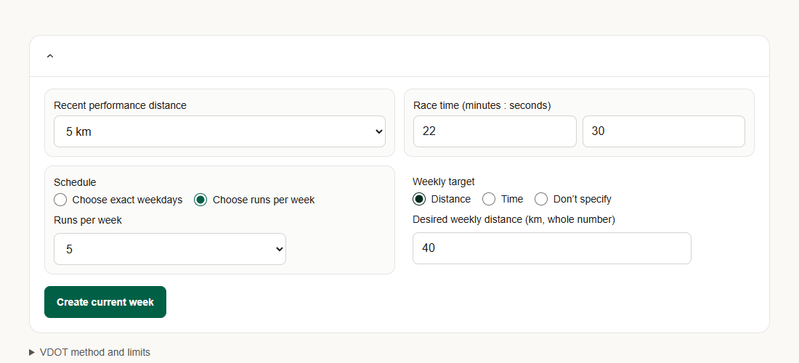
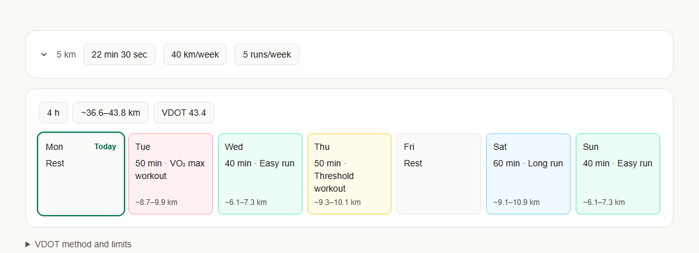
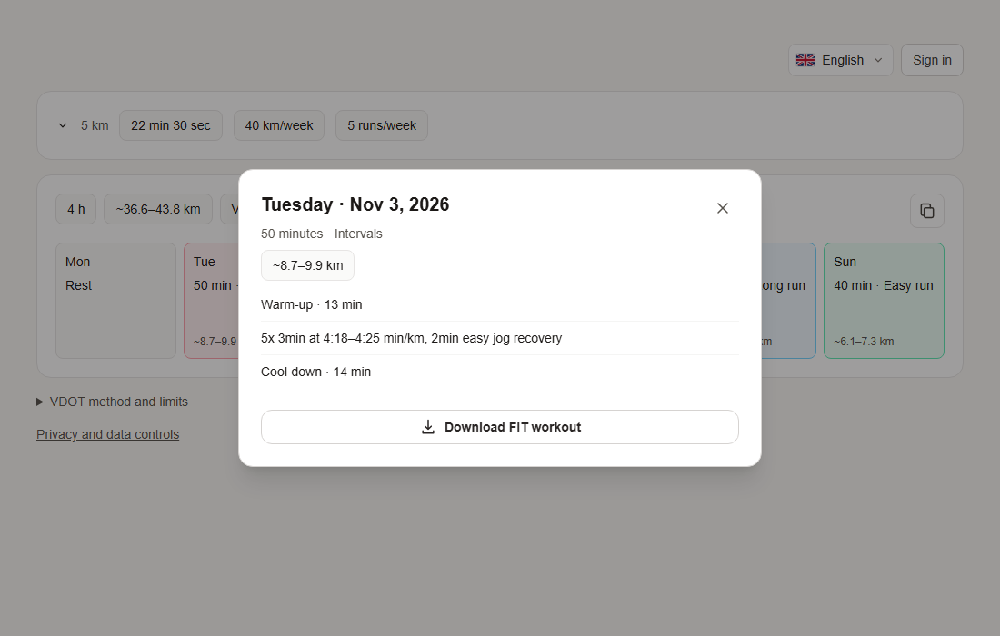

# Run Week

A frontend-first browser-local running planner, built with Next.js
App Router, React, TypeScript, Tailwind CSS, and ESLint.







## Getting started

Use Node.js 24 LTS and npm. From this directory:

```sh
npm ci
npm run dev
```

Open [localhost:3000](http://localhost:3000).
On Windows, use `npm.cmd` if PowerShell blocks `npm.ps1`.

## Commands

| Command | Purpose |
| --- | --- |
| `npm run dev` | Start the development server |
| `npm run lint` | Run ESLint |
| `npm run typecheck` | Generate route types and check TypeScript |
| `npm run build` | Create the production build |
| `npm start` | Serve the production build |

## Structure

```text
.github/
  agents/                 Project-specific coding and review agents
src/
  app/                    Routes, root layout, metadata, global styles
  features/
    i18n/                 Locales, translated messages, language selector
    running-programs/
      components/         Running-program UI
      types.ts            Domain types independent of React
      domain.ts           Pure VDOT, schedule and workout generation functions
      storage.ts          Versioned localStorage validation
      use-planner-store.ts Hydration-safe browser store
public/                   Static assets
```

The home page supports performance/profile setup and a current-week plan. Profile
and the current week are saved only in this browser's localStorage. There is no
account, backend, database or cross-device sync.
Clearing browser data deletes the planner. Failed writes show an in-memory-only
warning; invalid saved data is not silently overwritten. System fonts keep builds
independent of external font services.

VDOT uses the Daniels–Gilbert race-performance equations. Changing the
performance distance prefills the race time with the equivalent time for the
same VDOT, based on the last complete time entered. Setup can use an optional desired weekly distance or desired weekly time. A
distance target is converted to duration using VDOT easy pace; a time target is
used directly. The resulting duration is distributed among workouts by type and
neighboring sessions. Without a target, session durations use the VDOT-based
baseline: the first easy run is the longest, and each additional easy run is
shorter, by a larger step and down to a lower floor for lower VDOT values. Easy
runs next to a key session or the long run get the shorter durations. The long
run is always longer than every easy run: if needed, 10-minute blocks are moved
to it from the longest easy run, keeping the weekly total. Existing
local planner data is migrated by estimating volume from its
saved workout durations and VDOT pace.

Easy pace estimates invert the oxygen-cost equation at 59–74% of VDOT. Full
equations and limits are shown in the UI. The plan retains the VDOT/profile
snapshot used to create it. These are illustrative estimates, not personalized
training or medical advice.

Generated workout categories follow the selected run count: one VO₂ max workout;
two runs (easy and VO₂ max); three runs (VO₂ max, easy, long); four runs (VO₂ max,
two easy, long); five or more (VO₂ max, easy, threshold, long, then additional
easy runs). The total weekly duration is allocated in proportion to workout-type
and neighboring-session weights. Workout and long runs are spaced as evenly as
the selected weekdays allow, with the long run favored for a weekend when
spacing is otherwise equal. Optional preferred days can be set for the VO₂ max
workout, the threshold workout, and the long run; each option is shown only when
the run count includes that session. With selected weekdays, preferred days must
be among them. With a run count, the run days are chosen to include the
preferred days and keep key sessions as far apart as possible. The displayed distance is a separate estimate based
on the VDOT easy-pace range. These are product heuristics, not scientifically
validated training rules.

VO₂ max sessions use VDOT-derived I-pace estimates and 3-minute repeats with
2-minute easy jog recoveries. Threshold sessions use VDOT-derived T-pace
estimates and continuous or repeated efforts, fitted to the planned session
duration. The pace ranges and example formats follow the [VDOT2 training
definitions](https://vdoto2.com/Calculator). These are illustrative sessions,
not individualized coaching advice.

Select a calendar day to view its workout details. The copy button copies the
week, including workout steps and paces, as plain text in the current language.
Non-easy workouts include an
option to download a Garmin FIT workout file. Files contain timed workout steps
and VDOT-derived pace targets where available. Transfer the downloaded file to
a compatible Garmin device using Garmin Connect or the device's supported
file-transfer method. Easy runs do not have FIT downloads; files are generated
in the browser and are not uploaded automatically.

Edit setup to update the current plan. Confirmation dialogs protect plan
replacement and deletion.

## Languages

The UI is available in English, French, German, Spanish, Portuguese, Polish,
Russian, Ukrainian, Belarusian and Italian. The default language is the first supported language in
the browser's language settings, with English as the fallback. The language
selector overrides it and stores the choice in localStorage (`run-week-locale`).
Translations live in `src/features/i18n/messages`; `en.ts` defines the message
shape and the other locales must satisfy it.

Language is resolved in the browser rather than through locale URL segments,
because the app is a single static page with browser-only data. FIT workout
names are converted to ASCII for Garmin watch fonts; Russian, Ukrainian and
Belarusian FIT files use English names.

## Architecture

Keep program-specific UI and logic in `src/features/running-programs`. Add shared
UI components when another feature needs them. Keep route composition in
`src/app`, introducing client components when interactivity is needed.

The route remains a Server Component; interactive planner UI and browser storage
are Client Components. Calculation and generation helpers are independent of
React. No test framework is configured; use the commands above to verify builds.

## Custom agents

The [`.github/agents`](.github/agents) directory contains project-specific
agents: the **Next.js Developer** implements changes, the **QA Engineer**
verifies acceptance criteria, the **Code Reviewer** reviews them, and the
**Feature Coordinator** orchestrates larger tasks.
